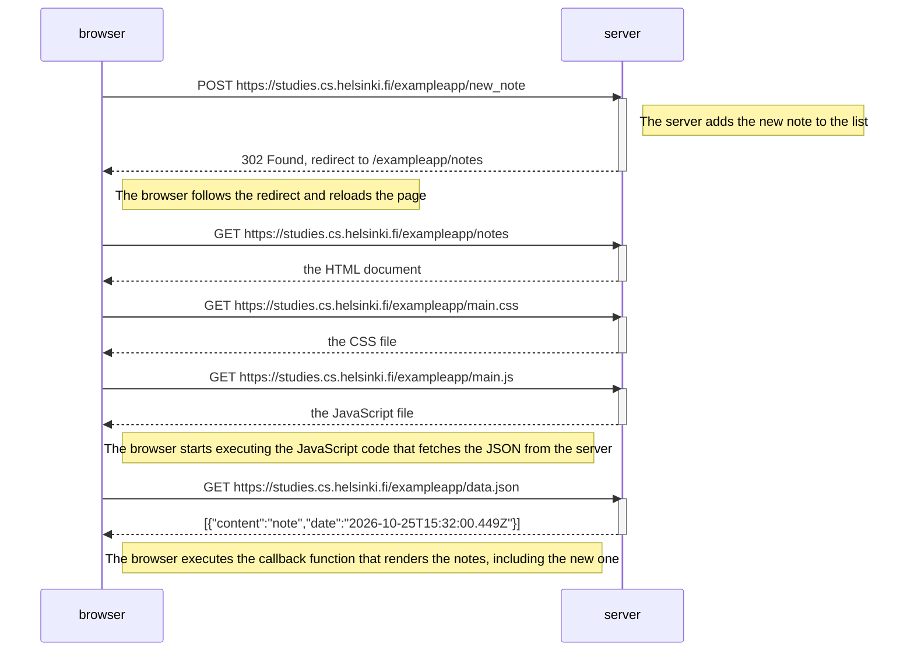
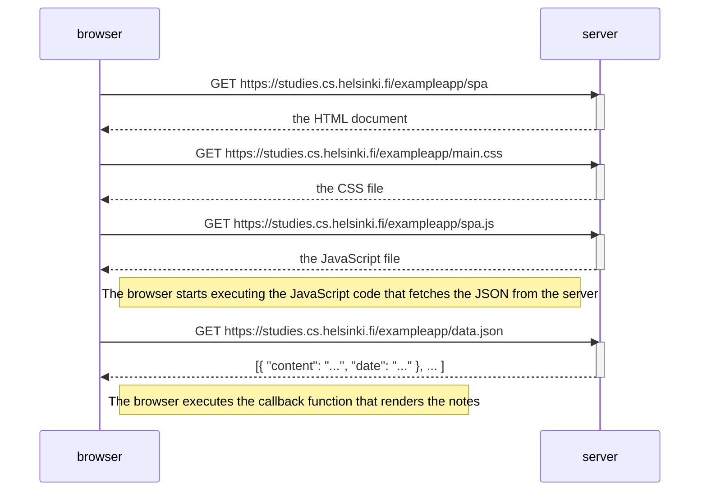
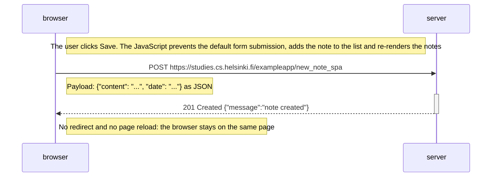

# Partie 0 — Fondamentaux des applications web

Cours : <https://fullstackopen.com/fr/part0>

Les exercices 0.1 à 0.3 sont des lectures (HTML, CSS, formulaires HTML) et n'ont rien à rendre.

## 0.4 — Nouvelle note (version classique)

Diagramme de ce qui se passe quand l'utilisateur crée une note sur <https://studies.cs.helsinki.fi/exampleapp/notes>.

## 0.5 — Application monopage (SPA)

Diagramme de ce qui se passe quand l'utilisateur ouvre <https://studies.cs.helsinki.fi/exampleapp/spa>.

## 0.6 — Nouvelle note dans la SPA

Diagramme de ce qui se passe quand l'utilisateur crée une note dans la version SPA.

